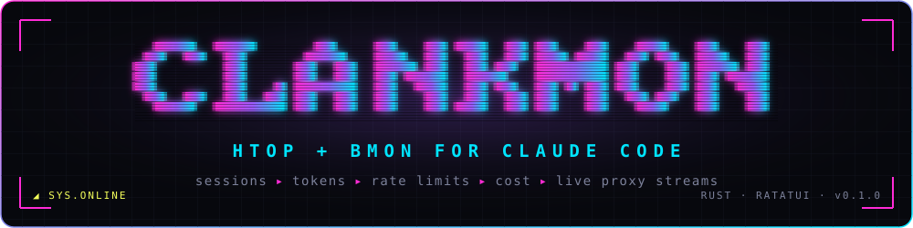
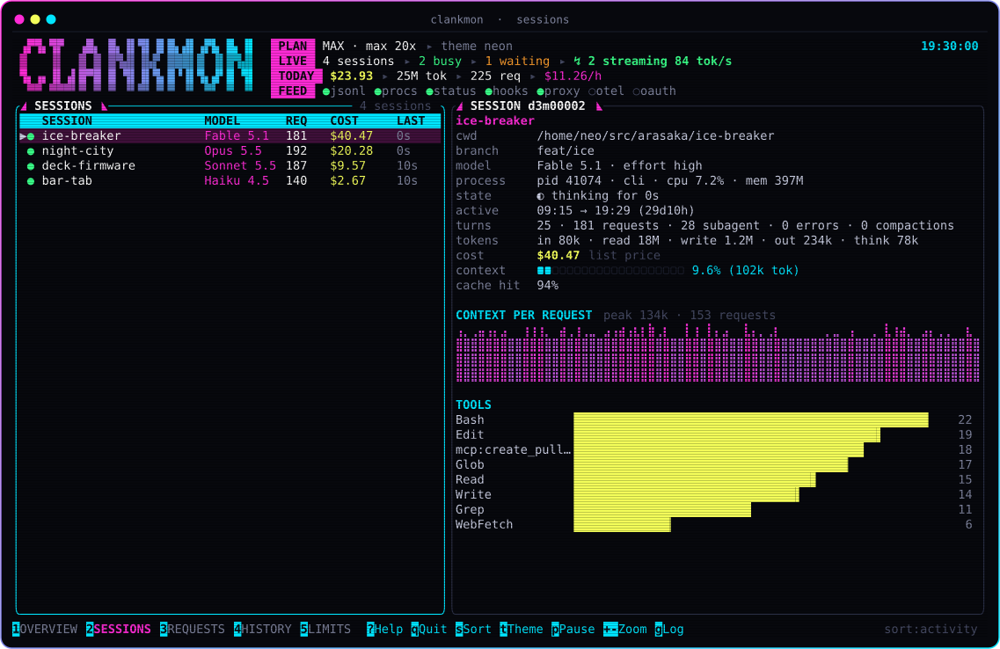
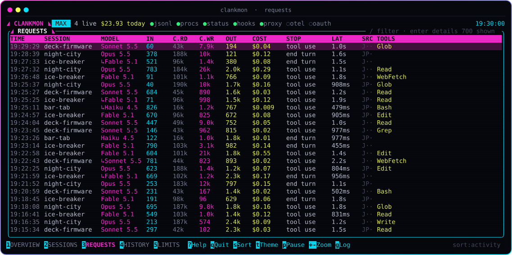
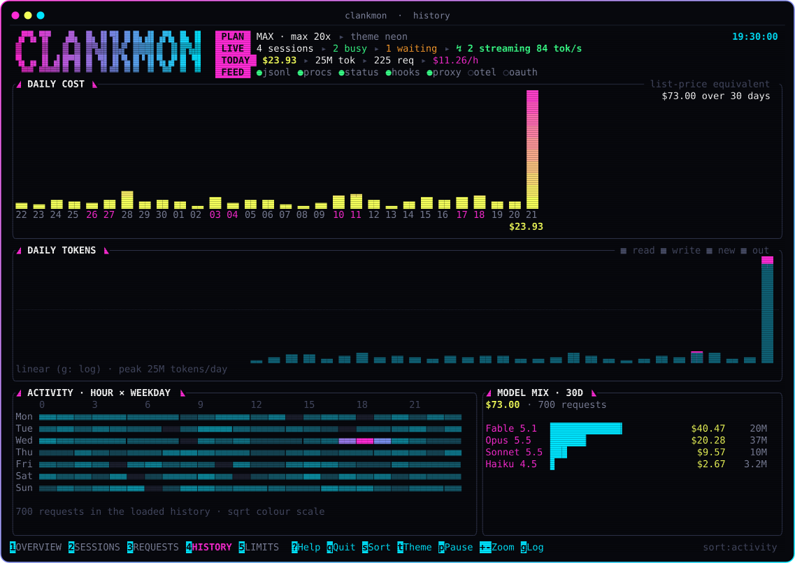
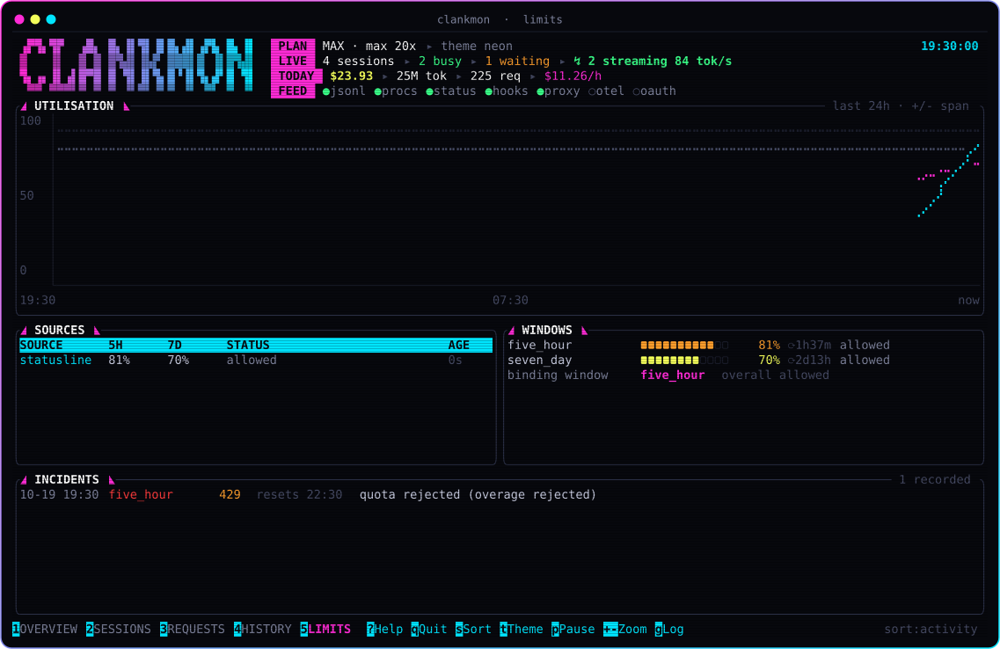
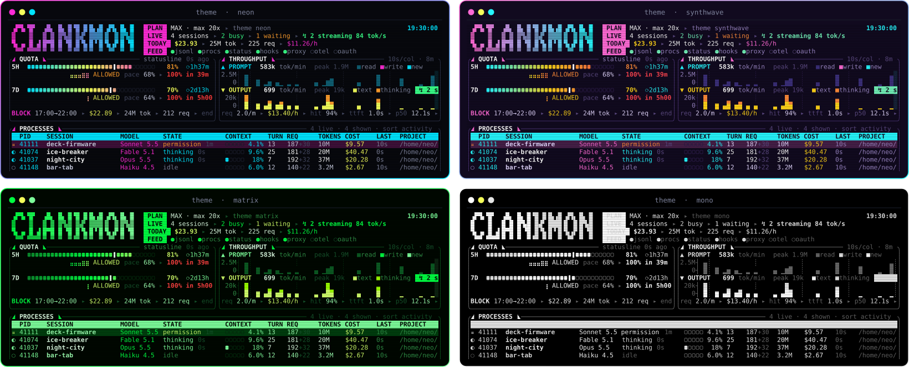
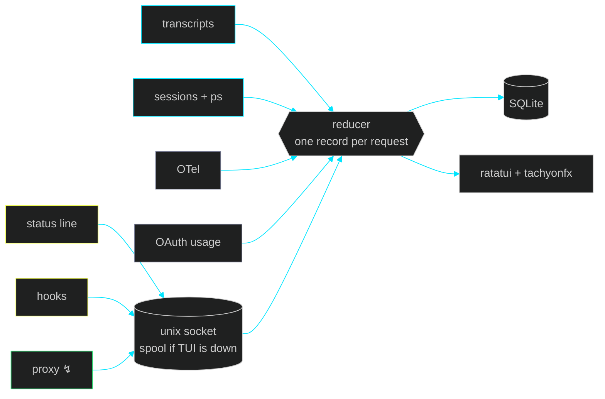

<p align="center">
  
</p>

<p align="center">
  <a href="https://github.com/rydn/clankmon/actions/workflows/ci.yml"></a>
  
  
  <a href="LICENSE"></a>
</p>

<p align="center">
  <b>A cyberpunk terminal monitor for <a href="https://code.claude.com">Claude Code</a>.</b><br>
  Live sessions, token throughput, rate limits and cost, streaming in as it happens.<br>
  <sub>One 9 MB Rust binary · reads what Claude Code already writes · nothing leaves your machine</sub>
</p>

<p align="center">
  
</p>

<p align="center"><sub>↑ <code>clankmon --demo</code>, rendered with <code>clankmon snapshot --svg</code>. Every name and number is synthetic.</sub></p>

<br>

## ◢ Features

<table>
<tr>
<td width="50%" valign="top">

**▸ Live processes, htop style**<br>
Every running Claude Code session shows its PID, model, effort, state, context fill, turns, requests, tokens, cache hit, cost, CPU, memory and project. The states are `◐ thinking`, `⚙ tool`, `⏸ permission` and `◇ compacting`. Sessions waiting on you sort to the top.

</td>
<td width="50%" valign="top">

**▸ Quota you can plan around**<br>
5-hour and 7-day subscription windows come with a pace marker, a reset countdown and a trend line. A least-squares projection says when you'll hit 100%. Per-model and API-key windows appear when a source reports them.

</td>
</tr>
<tr>
<td valign="top">

**▸ bmon-style throughput**<br>
Stacked graphs of prompt and output tokens per minute, aligned to the wall clock so columns never reshuffle. A smooth "now" rate, a spike-proof axis with a `▲` overflow cap, and zoom from 1-second to 15-minute columns.

</td>
<td valign="top">

**▸ Streams, live through the proxy**<br>
With the proxy on, prompts land the moment a request starts and output fills the live column while the model types. In-flight requests show elapsed time, TTFT and tokens per second. Final counts reconcile exactly.

</td>
</tr>
<tr>
<td valign="top">

**▸ The wire**<br>
A feed of every API turn: tokens by kind, cost, stop reason, latency, tools called, and which sources saw it. Filter with <kbd>/</kbd> and open any request for its full record, including rate-limit headers.

</td>
<td valign="top">

**▸ Cost at list price**<br>
Every request is priced from an embedded, overridable table that knows the 5-minute and 1-hour cache-write rates. Daily, per-model and per-session totals add up to the cent.

</td>
</tr>
<tr>
<td valign="top">

**▸ A console with style**<br>
Four themes, pure Unicode (no Nerd Font), true colour with an automatic 256-colour fallback, and `NO_COLOR` support. tachyonfx effects run only while they're visible.

</td>
<td valign="top">

**▸ Light on its feet**<br>
A 30-day backfill of 560 MB of transcripts takes under a second and peaks under 50 MB. Idle CPU is about 0.4%. The status line and hook clients run in about 4 ms.

</td>
</tr>
</table>

## ◢ Install

```sh
cargo install --git https://github.com/rydn/clankmon   # Rust 1.90+
clankmon install    # feed live quota from Claude Code (asks first, backs up settings.json)
clankmon            # jack in
```

<kbd>clankmon doctor</kbd> shows which data sources are live and how to switch on the rest. <kbd>clankmon --demo</kbd> runs the whole UI on synthetic traffic.

## ◢ Views

<table>
<tr>
<td width="50%"><b>2 · SESSIONS</b>, every session with its context growth and tool mix<br></td>
<td width="50%"><b>3 · REQUESTS</b>, the filterable log with in-flight streams on top<br></td>
</tr>
<tr>
<td><b>4 · HISTORY</b>, 30-day cost and tokens, an hour × weekday heatmap and the model mix<br></td>
<td><b>5 · LIMITS</b>, the utilisation chart, per-source readings and 429 incidents<br></td>
</tr>
</table>

## ◢ Themes

<p align="center"></p>
<p align="center">Cycle with <kbd>t</kbd>, or set <code>--theme neon | synthwave | matrix | mono</code>.</p>

## ◢ Data sources

clankmon merges every source into **one record per API request**, keyed by Anthropic's request ID, so nothing is counted twice. The `SRC` column shows which sources saw each request: <code>J</code> for transcript, <code>P</code> for proxy, <code>O</code> for OTel.

| | Source | Setup | What it adds |
|:-:|---|---|---|
| ● | **Transcripts** `~/.claude/projects/**/*.jsonl` | none | every API turn: tokens by kind, model, stop reason, tools, subagents, effort, 429s and quota rejections |
| ● | **Session registry** `~/.claude/sessions` + `ps` | none | the live process list, CPU and memory |
| ◆ | **Status line** | `clankmon install` | 5h/7d utilisation and resets (Pro/Max), context %, Claude Code's own cost, prompt-cache stats |
| ◆ | **Hooks** (async, never block) | `clankmon install` | permission waits, compaction, session start/end, tool failures |
| ↯ | **Proxy** | `clankmon proxy` + `ANTHROPIC_BASE_URL` | live streams, exact server-side limits on every response, TTFT, generation speed, request shape, 429 details |
| ○ | **OpenTelemetry** | `clankmon install --otel` + `clankmon --otel` | Claude Code's `api_request`, `tool_result` and `api_error` events |
| ○ | **OAuth usage** | `clankmon --oauth` | per-model weekly limits and extra usage from the endpoint behind `/usage`. It's undocumented and rate limited, so clankmon polls it every 10 minutes or less often and backs off. |



<details>
<summary><b>▸ The proxy, and live streaming</b></summary>
<br>

```sh
clankmon proxy                                  # 127.0.0.1:8484 → api.anthropic.com
export ANTHROPIC_BASE_URL=http://127.0.0.1:8484 # in the shell where you run claude
```

The proxy forwards requests untouched, including auth, and streams responses back chunk by chunk while a copy feeds an SSE parser. It works with subscription (OAuth) and API-key auth. While a reply streams, clankmon sees:

- **Prompt tokens** the moment `message_start` arrives, so the prompt graph moves when a request starts, not when it ends.
- **Estimated output tokens** at most every 200 ms, from streamed characters (about 4 per token). Hidden thinking streams no text, so the estimate runs low during thinking.
- **Exact final counts** from `message_delta`. The reducer subtracts what was already drawn, so totals are exact.

The proxy records token counts, timings and headers, never prompt or completion text unless you pass `--capture-bodies`. Host it inside the TUI with `clankmon --proxy`, or run it standalone. The standalone proxy forwards to a running TUI, or spools records for the next start.

</details>

<details>
<summary><b>▸ Status line</b></summary>
<br>

`clankmon install` points Claude Code's status line at clankmon. An existing status line is **wrapped**, not replaced: its output is shown unchanged and clankmon just reads the JSON on the way past. Without one, clankmon prints its own neon line with model, context, quota and cost. `clankmon uninstall` restores whatever was there before.

</details>

## ◢ Keys

| | |
|---|---|
| <kbd>1</kbd>–<kbd>5</kbd> <kbd>Tab</kbd> | overview · sessions · requests · history · limits |
| <kbd>↑</kbd><kbd>↓</kbd> <kbd>j</kbd><kbd>k</kbd> <kbd>PgUp</kbd><kbd>PgDn</kbd> | select |
| <kbd>Enter</kbd> | open the session (overview) or request detail (requests) |
| <kbd>/</kbd> | filter requests by session, model, stop reason, tool or `error` |
| <kbd>s</kbd> | sort processes: activity, cost, tokens, cpu, name |
| <kbd>+</kbd> <kbd>-</kbd> | graph column width 1s…15m · chart span in Limits |
| <kbd>g</kbd> <kbd>t</kbd> <kbd>f</kbd> | log scale · theme · effects |
| <kbd>p</kbd> / <kbd>Space</kbd> | pause the feed (events are buffered) |
| <kbd>?</kbd> <kbd>q</kbd> | help · quit |

## ◢ Commands

```text
clankmon [--theme T] [--no-fx] [--days N] [--proxy[=PORT]] [--otel[=PORT]] [--oauth] [--demo]
clankmon install [--statusline] [--hooks] [--otel] [--dry-run] [--yes]
clankmon uninstall [--dry-run] [--yes]
clankmon proxy [--port P] [--upstream URL] [--print-env] [--capture-bodies] [--quiet]
clankmon doctor
clankmon snapshot [--view V] [--width W] [--height H] [--ansi | --svg [--title T]]
clankmon export [--format csv|jsonl|daily] [--since 7d] [-o FILE]
clankmon config
```

`snapshot --svg` renders a frame of your real dashboard as a crisp, shareable SVG. Every image on this page was made that way.

<details>
<summary><b>▸ Configuration</b></summary>
<br>

`~/.clankmon/config.toml` is optional. Run `clankmon config` for a commented example.

```toml
theme = "synthwave"
history_days = 30

[proxy]
enabled = true          # host the proxy in the TUI

[[pricing]]             # add or override a model (USD per million tokens)
match = "claude-opus-5-5"
input = 4.0
output = 20.0
cache_read = 0.20
```

`CLAUDE_CONFIG_DIR` (or `--claude-dir`) points at a non-default Claude Code directory. `CLANKMON_HOME` moves clankmon's own state, and `CLANKMON_LOG` sets the log filter (the log is at `~/.clankmon/clankmon.log`).

</details>

## ◢ Privacy

Everything stays on your machine. clankmon reads Claude Code's local files. It talks to the network only through the opt-in proxy, which forwards your own requests, and the opt-in OAuth poller, which makes one read-only call with Claude Code's token. clankmon never stores or refreshes that token. Telemetry from Claude Code goes only to the loopback receiver you start.

## ◢ Building

```sh
cargo test                                 # unit, render-snapshot and proxy/OTLP integration tests
cargo clippy --all-targets -- -D warnings
cargo run --release --example docs         # regenerate docs/assets/*.svg from the demo
```

The data layer lives in `src/collect`, `src/state.rs` and `src/windows.rs`; the proxy in `src/proxy`; the UI and SVG renderer in `src/ui`.

## ◢ Prior art

Inspired by [ccusage](https://github.com/ryoppippi/ccusage) (transcript parsing, 5-hour blocks), [Claude-Code-Usage-Monitor](https://github.com/Maciek-roboblog/Claude-Code-Usage-Monitor) (forecasting), [claudeMon](https://github.com/woffko/claudeMon) (status-line limits feed), [claude-rate-monitor](https://github.com/nsanden/claude-rate-monitor) (unified limit headers), and of course htop and bmon.

<p align="center"><sub>MIT · built with <a href="https://ratatui.rs">ratatui</a>, <a href="https://github.com/ratatui/tachyonfx">tachyonfx</a>, tokio and hyper</sub></p>
